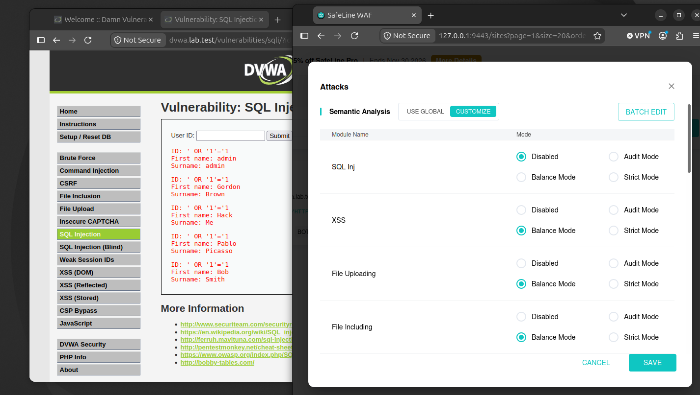
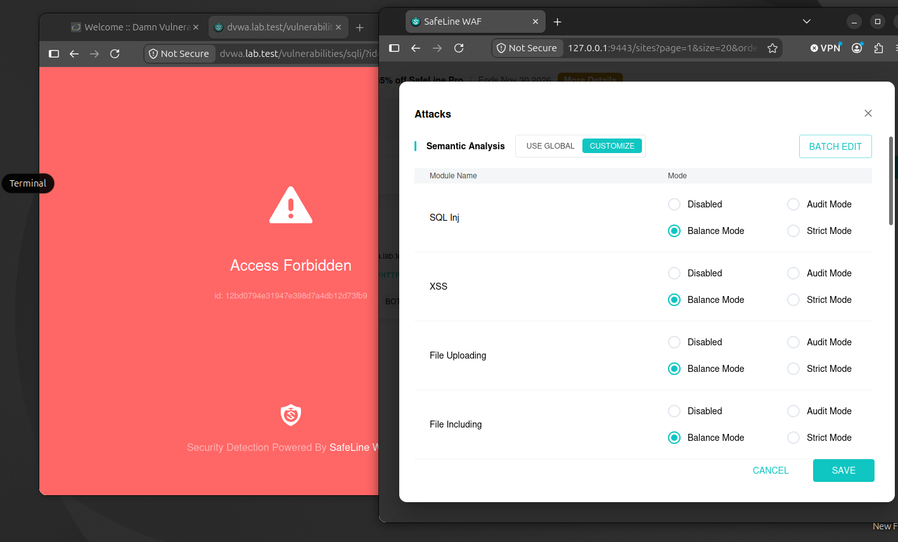
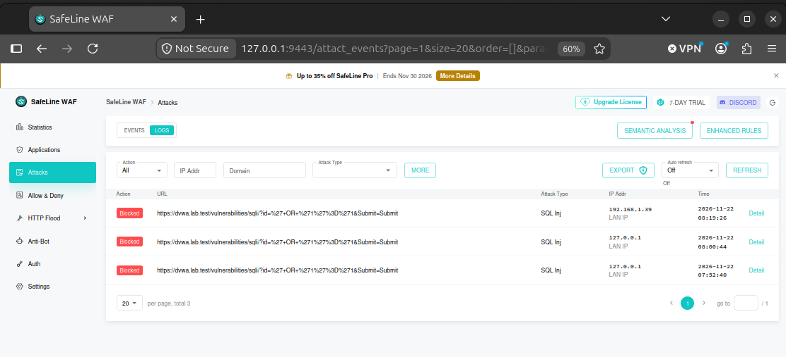
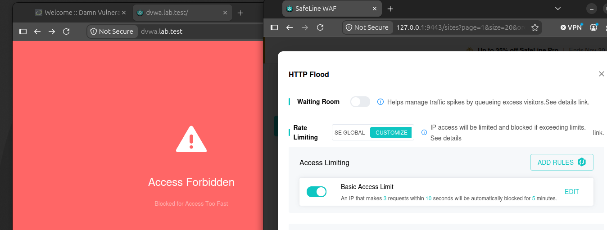
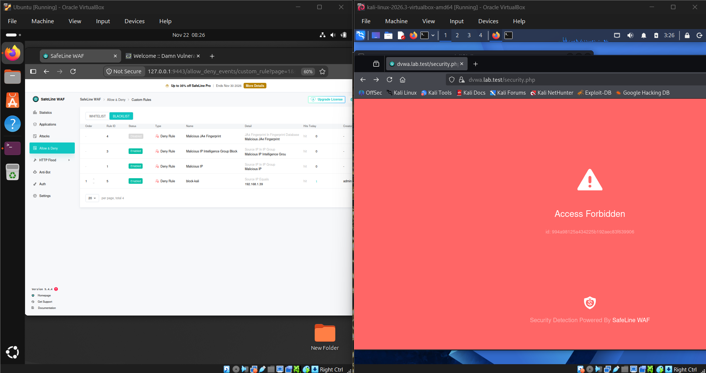
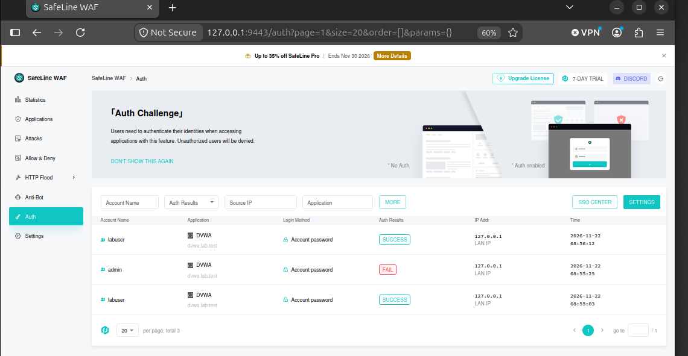

# WAF Home Lab: SafeLine + DVWA + Kali

A home lab where I put a web application firewall (SafeLine) in front of a deliberately vulnerable web app (DVWA), attacked it from Kali Linux, and checked what the WAF blocked.

> **Warning:** DVWA is deliberately vulnerable. Run this lab only on a private network and never expose DVWA to the internet. The compose file publishes DVWA on port 8080 so SafeLine can reach it, which makes it reachable by other devices on the same network.

## Architecture

```
Kali VM (attacker) --HTTPS 443--> SafeLine WAF --HTTP 8080--> DVWA (Docker)
```

- **Ubuntu VM (VirtualBox):** runs Docker, SafeLine and DVWA
- **Kali Linux VM:** the attacker, on the same bridged network
- **SafeLine 9.4.4:** reverse proxy, with a self-signed certificate for `dvwa.lab.test`
- **DVWA:** the `vulnerables/web-dvwa` image, security level Low

## What I tested

| Test | Result |
|---|---|
| Normal request (User ID `1`) | Allowed |
| SQL injection (`' OR '1'='1`), protection disabled | Succeeded: the user list was dumped |
| SQL injection, protection on (balanced mode) | Blocked: "Access forbidden" |
| HTTP flood (3 requests in 10 seconds) | Source IP blocked for 5 minutes |
| Custom deny rule (source IP = Kali) | Every request blocked, rule hit count increased |
| Authentication rule | Sign-in page shown before DVWA |

## Screenshots

**SQL injection succeeding with the WAF protection off**


**SQL injection blocked by SafeLine**


**Attack log showing Kali as the source**


**HTTP flood block**


**Custom deny rule**


**Authentication sign-in page**


## How to reproduce

1. Install Docker on an Ubuntu machine.
2. Run `./safeline/install.sh` to install SafeLine (it is itself a set of Docker containers).
3. Run `docker compose up -d --build` to start DVWA and the Kali container.
4. Run `./scripts/gen-cert.sh` to create a self-signed certificate.
5. In the SafeLine web UI (port 9443): add the certificate, then add an application for `dvwa.lab.test` on port 443 with the upstream `http://<host-ip>:8080`.
6. Add `<host-ip> dvwa.lab.test` to `/etc/hosts` on the machine you attack from.
7. Open DVWA at `http://<host-ip>:8080/setup.php`, create the database, and set security to Low.

## Limitations

- Adding the application in SafeLine is done by hand in its web UI, so the repo doesn't rebuild the whole lab with one command.
- I ran the attacks from a Kali VM, not the Kali container in the compose file.
- I tested SQL injection with one simple payload, in disabled and balanced modes only. I did not test strict mode, XSS or other attack types.
- The test steps follow a YouTube tutorial. I rebuilt the DVWA and Kali parts as Docker containers instead of VMs.

## What I learned

- **A WAF is a reverse proxy.** Traffic only reaches the app through SafeLine on port 443. Turning SQL injection protection off and on showed exactly what the WAF was preventing: the same input dumped the user table without it and got "Access forbidden" with it.
- **Container networking trips you up.** `127.0.0.1` inside SafeLine's container is the container itself, so the upstream had to be the Ubuntu VM's network address, not localhost. Recreating the DVWA container also wipes its database, so DVWA has to be set up again.
- **The protections stack on each other.** The low flood limit and the deny rule blocked everything from Kali, so I had to switch them off between tests, or they would have hidden the other protections.
- **SafeLine keeps separate logs.** SQL injection shows up under Attacks, while the flood block shows up under HTTP Flood.
- **Keep secrets out of the repo.** The private key lives in an ignored `certs/` folder, and the GitHub token I used had limited scope and a short expiry.
